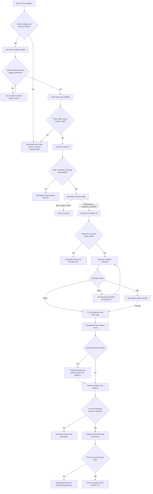

# Candidate-Driven Job Discovery Architecture

Status: Approved for MVP implementation
Date: 2026-07-25

## Objective

Reduce manual job-search effort without weakening the evidence boundary used for application tailoring. Keep candidate facts, source discovery, and final fit decisions independently testable.

## System boundary

The system contains three domain skills and an orchestration layer:

```text
Trigger / Orchestrator
        |
        v
Skill A: Candidate Profile  --->  Skill B: LinkedIn Job Discovery
        |                                  |
        +--------------------------+       v
                                   +--> Skill C: Tailor Job Application
```

The pipeline is not strictly linear. Discovery metrics may propose changes to the search policy or query portfolio, but must never rewrite verified candidate facts.

## Skill A: candidate profile and search policy

Skill A is implemented as `prepare-candidate-job-search`. It owns raw CV onboarding, the canonical evidence-linked candidate profile, the durable candidate confirmation ledger, and the reviewable search policy. Downstream skills read and validate these artifacts but do not rebuild them.

Skill A maintains three distinct artifacts.

### `candidate-profile.json`

Store atomic, evidence-linked candidate facts such as education, experience, skills, languages, location, and work authorization. Mark conflicts, unknowns, and time-sensitive facts. Do not store search heuristics as candidate facts.

### `job-search-policy.json`

Store preferences and discovery controls such as role families, preferred domains, seniority, employment types, locations, negative preferences, and title-language handling.

### `candidate-confirmations.json`

Store durable candidate answers with their question, typed answer, timestamp, intake or migration provenance, lifecycle status, and explicit profile, policy, or screening scope. Conversation is an intake channel rather than the system of record. Search preferences do not become final screening gates unless an active scoped confirmation and resolved policy item explicitly authorize that use.

Candidate language ability and title-language handling are different concepts. For example, `German: A2` is a candidate fact, while `skip high-confidence German titles` is a reversible search policy.

Skill A does not encode LinkedIn Boolean syntax and does not control a browser.

Implementation controls:

- draft policies begin with explicit open preference questions;
- resolved policy items link to active confirmation-ledger entries with matching answers;
- every search target cites candidate fact IDs or resolved confirmation IDs;
- a policy cannot become `confirmed` while a required confirmation is open;
- candidate profile and policy IDs must match.

## Skill B: LinkedIn job discovery

Skill B is named `discover-linkedin-job-postings`. It consumes the candidate profile and job-search policy, then performs four stages.

### 1. Query portfolio

Generate multiple source-specific query statements from approved profile fields and the search policy. Each query records:

- query ID and purpose;
- positive-intent natural-language Smart Search statement;
- LinkedIn filters;
- rationale and known noise risks;
- lifecycle status: `draft`, `active`, or `retired`.

Only `active` queries may run automatically. Approval of a structured Skill A search target also authorizes its deterministic compiled query, so a confirmed policy's approved targets generate `active` queries without a duplicate activation gate. Proposed targets and targets in draft policies generate `draft` queries. Scheduled executions must not silently rewrite active queries.

The Collector compiles structured Skill A search targets into Smart Search statements with `generate_query_portfolio.py`; exclusions stay in deterministic first-level triage rather than unsupported search syntax. If must-groups, exclusions, or target-level filters change, the target returns to `proposed` and must be reviewed again. Before browser execution, `validate_discovery_inputs.py` requires matching candidate IDs, profile and policy source versions, confirmation-ledger fingerprint and links when referenced, a confirmed policy for active queries, and no required open confirmations.

### 2. Browser execution

Enter Smart Search through its visible controls in the authenticated browser and submit each active query's exact compiled text. Apply and visibly verify `Past 24 hours` for daily runs and record `semantic_relevance`; URL parameters are supporting evidence rather than a substitute for visible verification. Collect exact-match cards until the visible related-results boundary or genuine exhaustion, respecting the canonical discovery skill's source-specific rules and safety stops.

Read only job listings and descriptions visible to the signed-in user. Do not call private LinkedIn APIs, enumerate unknown job IDs, bypass access controls, auto-apply, auto-save, or create alerts.

### 3. First-level filtering

Apply cheap, high-confidence, reversible rules before opening every JD. Examples include:

- explicit excluded title families;
- internship or working-student roles;
- incompatible seniority;
- high-confidence German title markers when enabled;
- duplicate LinkedIn job IDs;
- explicit metadata conflicts such as employment type or location.

Use `FORWARD`, `MANUAL_REVIEW`, or `SKIP_FIRST_LEVEL`. Do not issue the final `PASS`, `HOLD`, or `FAIL` gate; that belongs to Skill C.

Never erase skipped jobs. Preserve job ID, title, company, URL, query provenance, matched rule, policy version, and skip reason so false positives can be audited and replayed.

### 4. JD extraction

For forwarded jobs, use job IDs collected from visible result cards to open canonical `/jobs/view/<id>/` pages in independent tabs. Extract details with settled-result semantics and a hard maximum concurrency of five, verify the job ID, expected title, and supported description heading, and checkpoint each attempt immediately. Use same-page `currentJobId` navigation and exact-card selection only as bounded per-job fallbacks.

Normalize the complete visible JD to schema.org `JobPosting` JSON plus readable Markdown. Cache by LinkedIn job ID and content hash. Re-read a known job only when its content changes or the user requests a refresh.

## Skill C: detailed screening and tailoring

`tailor-job-application` consumes:

- the versioned candidate profile from Skill A;
- the candidate confirmation ledger and confirmed search policy when candidate statements or candidate-side gates affect screening;
- one normalized JobPosting from Skill B, or an equivalent PDF, URL, or pasted JD.

When the requested workflow includes screening, it assesses every retrieved or cached JD and applies `PASS`, `HOLD`, or `FAIL`. `PASS` and explicitly `OVERRIDDEN` jobs advance automatically through drafting and independent content review. There is no duplicate fit-approval gate, but new facts, ambiguous claims, evidence conflicts, and key-experience deletion/omission/material compression require scoped user approval before changing content. Pending decisions checkpoint the case before final generation.

Skill C must reuse the canonical valid candidate profile, ledger, and policy. Missing, stale, conflicting, or fingerprint-mismatched candidate artifacts return to `prepare-candidate-job-search`; Skill C must not silently rebuild them. A candidate-side hard gate uses `hardness_basis: candidate_policy` and cites both the resolved policy item and active scoped ledger confirmation. Skill C must not contain LinkedIn DOM or query-generation logic.

## End-to-end gates



Human decisions cover initial profile/search onboarding, unresolved `HOLD` facts, explicit overrides of `FAIL`, and scoped sensitive-content changes. Supported editorial refinements, artifact validation, triage, screening, `PASS` advancement, file building, and final QA run automatically within those boundaries. Automatic document generation does not authorize application submission. The graph describes an explicitly requested end-to-end run, not the discovery-only daily aliases.

## Orchestration layer

Manual runs, schedules, and email events are orchestration concerns rather than Skill B responsibilities.

### MVP manual daily operating mode

Before unattended scheduling is production-ready, use a once-daily conversational trigger in the Codex desktop app:

1. Open the project in Codex and ensure the in-app browser is available.
2. Ask Codex to run today's job search for the candidate, for example: `Run today's job search for <candidate-id> and continue through screening and PASS CV generation.`
3. Use the active `daily` Smart Search portfolio, visibly verify `Past 24 hours`, record `semantic_relevance` ranking, and use a stable date-based run ID.
4. Resolve LinkedIn login expiry, CAPTCHA, or access challenges manually in the visible in-app browser, then resume the same run.
5. Automatically pass every validated `retrieved` or `cached` JD into detailed screening.
6. Automatically generate and QA a JD-specific CV for every `PASS` or explicitly `OVERRIDDEN` result.
7. Ask the candidate only for unresolved `HOLD` facts. Preserve `FAIL` results without generating a CV unless explicitly overridden.
8. End with a run summary covering query counts, skips, retrieved JDs, screening gates, generated CVs, warnings, and incomplete stages.

Run only one daily search at a time. If a daily run is missed or materially fails, use a manually requested recovery window such as Past 48 hours or Past week and rely on job-ID/content-hash deduplication; do not assume the next strict Past 24 hours run covers the gap.

- A scheduled trigger invokes Skill B with a stable run ID and the current active query portfolio.
- Daily production triggers use a dedicated `daily` run profile with a visible `Past 24 hours` filter and Smart Search `semantic_relevance` ranking. Broader windows belong to an explicitly requested, bounded `capability_test` profile.
- An email connector may extract a LinkedIn alert URL and pass the event payload to Skill B.
- Skill B remains idempotent by deduplicating trigger IDs and LinkedIn job IDs.
- Authentication expiry, CAPTCHA, or a material page-structure change stops the run and requires user attention.

### Daily automation readiness gaps

Before unattended daily execution, add:

1. A durable end-to-end runner and state machine rather than relying on an interactive prompt to coordinate every step.
2. A run ledger with locks, stable trigger IDs, per-query watermarks, profile/policy/query fingerprints, and resume state for query, card, JD, screening, and CV stages.
3. An overlap window plus deduplication. A strict Past 24 hours query executed late or after a failed day can miss boundary postings; use a configurable overlap while keeping LinkedIn job ID and content-hash idempotency.
4. Authentication and browser preflight, explicit handling for login expiry, CAPTCHA, DOM drift, empty partial loads, rate limits, bounded retry, and backoff.
5. Runtime budgets and quotas for queries, cards, detailed JDs, PASS jobs, and CV builds so an unusually large day cannot overrun the next schedule.
6. A notification summary that distinguishes normal zero-result runs from partial failure, blocked `HOLD`, challenge state, and completed CV outputs.
7. Candidate-profile freshness rules for changed CVs, expired facts, work authorization, contact data, and fingerprint mismatch.
8. A retention policy for raw checkpoints, JDs, screening files, generated CVs, and scheduled-task runs.
9. A concurrency policy. This non-Git project is modified directly by scheduled tasks, so overlapping runs need a workspace lock and atomic writes.
10. A scheduled-environment forward test proving that the authenticated in-app browser and required local document tooling are available without interactive approvals.
11. Compliance controls: bounded visible-page access, no private API use, no ID enumeration, challenge stop, and periodic review of LinkedIn rules applicable to automated access.
12. Separation of CV generation from submission. Auto-generated CVs may be produced unattended, but saving/applying on LinkedIn remains out of scope unless separately designed and authorized.

### Accepted MVP known issues

The manual daily operating mode intentionally accepts the following limitations until unattended scheduling is implemented:

- no background scheduler; the candidate must open Codex and trigger the run each day;
- dependence on the current desktop app, project availability, and authenticated in-app browser session;
- manual recovery for login expiry, CAPTCHA, access challenges, and material LinkedIn DOM changes;
- no end-to-end durable state machine or automatic resume across every pipeline stage;
- incomplete transaction atomicity across query collection, screening, and document generation;
- no workspace lock beyond the operating rule that only one run is started at a time;
- query searches remain sequential, while independent JD detail extraction is bounded to a maximum concurrency of five;
- a strict Past 24 hours window may miss postings after a skipped or failed run unless a broader recovery run is requested;
- no production quota or runtime-budget enforcement; accepted for MVP because expected daily eligible volume is low;
- no external notification channel; completion, `HOLD`, and error results remain in the active Codex task and local artifacts;
- no automatic application submission or LinkedIn account mutation.

These are operational known issues, not blockers for the conversational MVP. Reassess them using actual run duration, failure frequency, result volume, and false-negative observations before enabling unattended scheduling.

## Artifact contracts

```text
discovery/<candidate-id>/
  candidate-profile.json or an evidence-linked profile reference
  job-search-policy.json
  query-portfolio.json
  runs/
    <run-id>/
      run-manifest.json
      jobs/
        <job-id>.json
        <job-id>.md
```

`run-manifest.json` records trigger provenance, query and policy versions, visible filter verification, discovered cards, first-level decisions, retrieval status, cache status, warnings, and aggregate metrics.

Each retrieved `<job-id>.json` is a schema.org `JobPosting`. The run manifest may add discovery metadata but must not inject candidate fit claims into the JobPosting record.

## Responsibility matrix

Application tailoring uses one content owner per job and one independent, read-only draft reviewer. Content proceeds through draft, independent review, scoped feedback resolution, then document generation and final visual/text QA. Review-only requests use the same review procedure without editing or generating files. See the canonical [draft-review procedure](../../.agents/skills/tailor-job-application/references/draft-content-review.md) and repository `AGENTS.md` for model routing, compact artifact handoffs, source-version audit reuse, and approval boundaries.

A directly supplied JD skips discovery and reuses valid candidate artifacts. For a single job, the root may be the content owner; the reviewer must be a separate independent agent. Multi-skill requests use serial stage workers, while each job keeps a separate execution context. These are agent instructions, not a programmatically enforced model scheduler. Actual worker models must be checked at dispatch; unavailable selections are reported rather than silently substituted. The daily-scan aliases stop after validated JD extraction even though a separately requested end-to-end run can continue to Skill C.

Supported editorial refinements run automatically. New facts, ambiguous claims/metrics, evidence conflicts, and deletion/omission/material compression of key experience require a concrete proposal and explicit scoped user approval before changing affected content, even during initial drafting. Candidate-fact revisions remain owned by profile preparation. Pending decisions checkpoint the case before final generation. This conversational review contract does not add a hard approval validator to the legacy document builder or promise a fixed token budget.

| Component | Owns | Must not own |
|---|---|---|
| Skill A | Candidate facts and search policy | LinkedIn syntax, browser actions, JD fit decisions |
| Skill B | Query portfolio, LinkedIn execution, first-level filtering, JD extraction | Final fit gate, CV or cover-letter edits |
| Skill C | Evidence-based screening and application tailoring | LinkedIn search execution or scheduling |
| Orchestrator | Manual, scheduled, or email-triggered invocation | Candidate evidence or JD interpretation |

## MVP acceptance criteria

1. Convert an active query and approved filters into a deterministic LinkedIn search URL.
2. Record visible filter verification rather than assuming URL parameters succeeded.
3. Classify title-level exclusions deterministically, including a configurable German-title policy.
4. Retain auditable metadata for every skipped job.
5. Deduplicate by LinkedIn job ID and preserve query provenance when the same job appears in multiple queries.
6. Emit validated run manifests and schema.org JobPosting artifacts.
7. Allow `tailor-job-application` to consume a selected discovery artifact without rebuilding a valid candidate profile.
8. Keep applicant-specific data outside reusable skill code.

## Deferred capabilities

- production-hardened unattended scheduled execution and recovery;
- email-event wiring;
- adaptive query promotion without user review;
- multiple job-board adapters;
- automated applications or modifications to LinkedIn account state.
