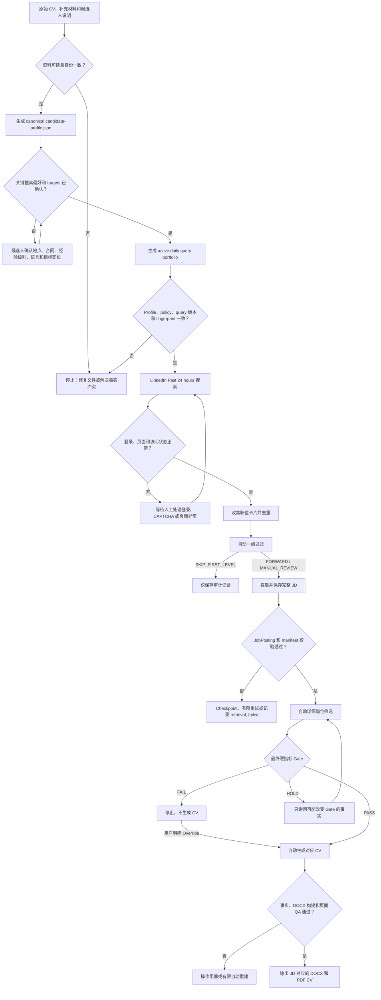

# Kuafu 中文端到端 Pipeline

## 1. Pipeline 目标

本流程从候选人提供原始 CV 开始，到输出与具体 JD 对应的 ATS CV 结束。流程优先保证：

- 所有候选人陈述均有证据来源；
- 搜索偏好和候选人事实相互分离；
- LinkedIn 读取行为可审计、可恢复；
- 硬指标优先于综合匹配分数；
- 只有 PASS 或明确 override 的岗位才生成 CV；
- 自动生成 CV 不等于自动提交申请。

## 2. 总体流程



## 3. 输入和核心产物

### 候选人输入

- 基础 CV：DOCX 或 PDF；
- 可选的其他 CV 版本；
- 证书、候选人说明或记忆文件；
- 对地点、工作类型、经验级别、语言过滤和目标职位的明确选择。

### 核心产物

```text
discovery/<candidate-id>/
  candidate-profile.json
  job-search-policy.json
  query-portfolio.daily.json
  runs/
    <run-id>/
      browser-checkpoint.json
      run-manifest.json
      run-summary.md
      jobs/
        <job-id>.json
        <job-id>.md
      screening/
        batch-manifest.json
        <job-id>/
          jd-normalized.md
          source-audit.md
          screening-report.json
          screening-report.md
          optimization-backlog.json

cases/
  <verified-employer-role>/
    input/
    work/
      case-config.json
      candidate-profile.json or profile reference
    review/
      cv-change-proposal.md
    output/
      <candidate>-<role>-cv.docx
      pdf/
        <candidate>-<role>-cv.pdf
```

## 4. Candidate profile 阶段

### 执行内容

1. 读取原始 CV 和补充材料。
2. 对 DOCX/PDF 进行文本提取和页面检查。
3. 建立原子事实，并保存稳定证据定位。
4. 标记事实状态：
   - `verified`
   - `source_claimed`
   - `needs_confirmation`
   - `expired`
5. 记录冲突和未验证陈述。
6. 生成 canonical profile fingerprint。
7. 将 profile 保存到候选人稳定目录。

### 门控

- 文件不可读：停止并要求修复。
- Candidate ID 冲突：停止。
- 关键事实来源矛盾：记录 conflict；必要时询问候选人。
- 不影响搜索的未知事实不会阻塞 search policy。

下游流程只能读取和验证该 profile，不得静默重建。

## 5. 搜索策略阶段

根据 profile 生成候选人专属搜索方向，每个 target 包含：

- target ID；
- 目标职位族；
- must-groups；
- exclude terms；
- 候选人事实依据；
- rationale；
- known noise；
- target status。

必须由用户确认的内容包括：

- 搜索地点和 remote 接受范围；
- employment type；
- LinkedIn experience level；
- title language policy；
- 第一批搜索目标。

批准 target 后，由其确定性编译出的 LinkedIn Query 自动成为 active，不再设置重复确认门。

## 6. Daily Query 阶段

正式 daily portfolio 默认使用：

- Date posted：Past 24 hours；
- Sort：Most recent；
- Employment type：Full-time；
- Experience level：由已确认 policy 决定；
- Location：由已确认 policy 决定。

只有以下条件全部满足时才允许运行 active Query：

- profile、policy 和 portfolio candidate ID 一致；
- profile `as_of` 和 fingerprint 一致；
- policy version 一致；
- policy 为 confirmed；
- 没有 required open confirmation。

## 7. LinkedIn 收集阶段

### 搜索初始化

1. 构造 LinkedIn 搜索 URL。
2. 直接导航到 URL。
3. 检查可见过滤器。
4. 只有 URL 参数未生效时才操作 UI 控件。

### 卡片收集

记录：

- LinkedIn Job ID；
- title；
- company；
- location；
- source URL；
- query IDs；
- visible status markers。

按 Job ID 去重。同一个职位出现在多个 Query 时，合并 query provenance。

如果页面显示 `No matching jobs found`，其后的 `Jobs you may be interested in` 推荐卡片不得视为 Query 命中。

## 8. 一级过滤阶段

一级过滤只使用高置信度、可逆规则。

### 输出状态

- `FORWARD`：读取完整 JD；
- `MANUAL_REVIEW`：title 信息不足，但仍读取 JD；
- `SKIP_FIRST_LEVEL`：命中明确排除规则，不读取 JD。

### 可用规则

- 明确排除的职位族；
- Internship 或 Working Student；
- 明显不兼容的 seniority；
- 配置启用时的高置信度德语 title；
- 重复 Job ID；
- 明确的 location 或 employment type 冲突。

一级过滤不得输出 PASS、HOLD 或 FAIL。所有跳过职位仍保留 URL、Job ID、来源 Query 和原因。

## 9. JD 提取阶段

对 `FORWARD` 和配置为读取的 `MANUAL_REVIEW`：

1. 优先使用 LinkedIn 搜索页 split pane。
2. 使用来自可见卡片的 Job ID 设置 `currentJobId`。
3. 验证打开的 title 与目标职位一致。
4. 验证 `About the job` 区域可见。
5. 提取完整可见 JD。
6. 每完成一个职位立即保存 checkpoint。
7. split pane 不可用时，对已发现 Job ID 使用一次有限 direct-page fallback。
8. 按 Job ID 和 content hash 使用缓存。

成功产出：

- schema.org JobPosting JSON；
- 可读 Markdown；
- run manifest；
- extraction warnings；
- cache 和 retrieval 状态。

所有 `retrieved` 或 `cached` JD 通过验证后自动进入详细 screening，不逐个请求确认。

## 10. 详细 screening 阶段

### 要求分类

- `hard`：明确或对核心职责不可缺少；
- `soft`：有利但不会单独阻止申请；
- `learnable`：可以学习，但不得作为当前技能写入 CV。

### 候选人状态

- `met`
- `partial`
- `unmet`
- `unknown`

### Gate 规则

| Gate | 条件 | 下一步 |
|---|---|---|
| PASS | 所有 hard requirements 均为 met | 自动生成 CV |
| HOLD | 没有 hard unmet，但至少一个 hard 为 partial/unknown | 只询问可能改变 gate 的事实 |
| FAIL | 至少一个 hard requirement 为 unmet | 停止 |
| OVERRIDDEN | 用户明确要求忽略 HOLD/FAIL 继续 | 自动生成 CV，并保留原始 gate |

权重分数或整体相似度不得覆盖硬指标 blocker。

## 11. CV 生成阶段

PASS 或 OVERRIDDEN 后自动执行：

1. 验证 employer 和 role title。
2. 创建 application case。
3. 保留原始 CV 和 JD 不变。
4. 审计基础 CV 的 ATS 结构。
5. 生成精确 change proposal：
   - 原文；
   - 建议文本；
   - 修改原因；
   - 候选人证据；
   - 风险。
6. 将 learnable gaps 存入 optimization backlog。
7. 生成 ATS-first DOCX。
8. 渲染并检查每一页。
9. 检查导出文本顺序和可选择性。
10. QA 通过后导出 PDF。

PASS 到 CV 输出之间不设置重复人工确认门。缺少必要联系信息、文件构建失败或 QA 失败属于操作性 blocker，而不是新的 fit gate。

## 12. 所有人工门控

| 位置 | 是否需要人工 | 说明 |
|---|---:|---|
| 原始材料不可读或身份冲突 | 可能 | 无法建立可信 profile |
| 初次搜索偏好和 targets | 是 | CV 不能推断候选人个人选择 |
| Query activation | 否 | 已由 target approval 覆盖 |
| 一级过滤 | 否 | 自动且可审计 |
| JD 进入 screening | 否 | Artifact validation 即为门控 |
| PASS 进入 CV 生成 | 否 | 自动进入 |
| HOLD | 是 | 只询问可能改变 gate 的事实 |
| FAIL override | 是 | 用户明确承担不匹配风险 |
| CV QA | 否 | 自动检查和有限重建 |
| 自动提交申请 | 不支持 | 需要未来单独设计和授权 |

## 13. MVP 每日运行方式

当前不依赖后台 scheduler。每天打开 Codex 后输入：

> 执行 `<candidate-id>` 今日职位搜索。使用 daily portfolio；完成 JD 提取后自动 screening；PASS 岗位自动生成并 QA CV；最后汇总结果。LinkedIn 登录异常时等待我处理。

正式运行结束时应汇报：

- 每个 Query 的结果数；
- 去重后职位数；
- 一级跳过数；
- JD retrieved、cached 和 failed 数；
- PASS、HOLD、FAIL 和 OVERRIDDEN 数；
- 生成的 CV；
- 警告和未完成阶段。

## 14. Recovery 运行

如果某天漏跑或正式运行失败，不要假设下一次 Past 24 hours 会覆盖缺口。

应明确请求：

> 执行 `<candidate-id>` recovery job search，使用 Past 48 hours 或 Past week；按 LinkedIn Job ID 和内容 hash 去重；后续 screening 和 PASS CV 生成规则保持不变。

Recovery 属于临时运行配置，不能替换 daily portfolio 的正式默认值。

## 15. MVP Known Issues

当前接受以下限制：

- 需要用户每天打开 Codex 并触发运行；
- 依赖 Codex 桌面应用、项目目录和已登录浏览器；
- 登录失效、CAPTCHA 和重大 DOM 变化需要人工处理；
- 尚无完整的端到端 durable state machine；
- Query、screening 和 CV 构建之间尚未形成完整事务原子性；
- 通过“一次只运行一个 daily task”规避并发冲突；
- Query 和 JD 当前串行处理；
- 严格 Past 24 hours 在漏跑后可能产生时间空洞；
- 尚无生产级数量和运行时间 quota；
- 尚无外部通知渠道；
- 不支持自动提交申请。

这些问题不阻塞人工每日触发的 MVP。应在积累真实运行时间、失败频率、PASS 数量和漏检数据后决定修复优先级。
